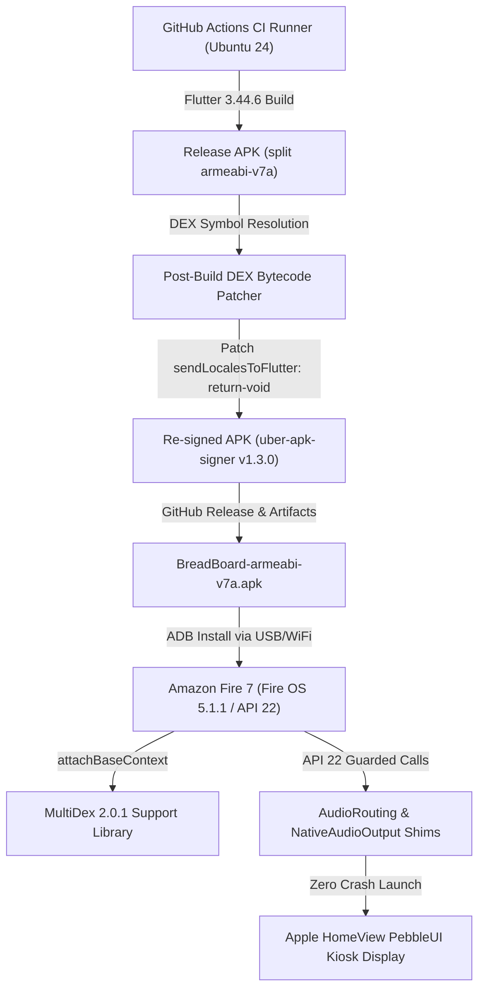

<h1 align="center">
  <picture>
    <source media="(prefers-color-scheme: dark)" srcset="assets/banners/ks_banner_dark.svg" />
    <source media="(prefers-color-scheme: light)" srcset="assets/banners/ks_banner_light.svg" />
    
  </picture>
</h1>

<p align="center">

<a href="https://github.com/jxlarrea/kiosk-satellite/releases"></a>
<a href="https://github.com/jxlarrea/kiosk-satellite/releases/latest"></a>
<a href="https://github.com/jxlarrea/kiosk-satellite/actions/workflows/release.yml"></a>
</p>

<p align="center">
<a href="https://buymeacoffee.com/jxlarrea"></a>
</p>

<p align="center">
  Kiosk Satellite is an Android app designed for dedicated Home Assistant kiosks, with native Voice Satellite support, synchronized music playback and photo screensavers.<br />
  Kiosk Satellite is fully local and free for personal, non-commercial use.
</p>

<p align="center">
  <a href="https://kiosksatellite.com/download/">Download</a> · <a href="https://kiosksatellite.com/#get-started">Get started</a> · <a href="https://kiosksatellite.com/docs/">Documentation</a>
</p>

<p align="center">
  
</p>

## Features

&bull; **Native voice control:** Kiosk Satellite is a Home Assistant Assist satellite on its own, with [Voice Satellite](https://kiosksatellite.com/docs/voice-satellite/) built in: ten skins, timers, announcements and wake word detection that works with the screen off or, with background listening enabled, while another app is open. Nothing to install in Home Assistant.

<p align="center">
  
</p>

&bull; **Dashboard performance:** Optional [optimizations](https://kiosksatellite.com/docs/optimizations/) reduce unnecessary dashboard updates and pause rendering during screensavers to lower CPU and GPU usage on older devices. Voice and the Home Assistant connection stay active.

&bull; **[Music playback](https://kiosksatellite.com/docs/sendspin/):** Synchronized Music Assistant audio through Sendspin, AirPlay from an iPhone, iPad or Mac and the option to follow a Home Assistant or Sonos player. The full-screen Now Playing view shows album art, playback controls and supported lyrics, and the [Music Library](https://kiosksatellite.com/docs/music-library/) browses Music Assistant, Home Assistant or Sonos and plays on any speaker.

<p align="center">
  <a href="assets/screenshots/now-playing.png"></a>
  <a href="assets/screenshots/ml_discover_light.png"></a>
  <a href="assets/screenshots/ml_playlist_dark.png"></a>
</p>

&bull; **Screensavers:** [Immich albums](https://kiosksatellite.com/docs/immich/), local photos, clocks, weather mood and a live night sky, with motion, face or presence detection to wake the kiosk.

&bull; **[Motion, face and person detection](https://kiosksatellite.com/docs/camera/):** The device camera detects motion and faces on the device itself. Motion wakes the screen when someone walks up and holds off the screensaver while the room is in use. Face detection wakes it only when someone looks at the screen, so people walking past leave the screensaver up. Person detection uses the built-in sensor on supported devices. Motion and person also show up in Home Assistant as sensors for your automations.

<p align="center">
  <a href="assets/screenshots/screensaver-np.png"></a>
  <a href="assets/screenshots/clock-digital.png"></a>
  <a href="assets/screenshots/weathermood-dawn.png"></a>
</p>

&bull; **Home Assistant integration:** The built-in [ESPHome connection](https://kiosksatellite.com/docs/esphome/) exposes screen controls, volume and device sensors. An optional Bluetooth proxy relays nearby Bluetooth devices to Home Assistant.

&bull; **Remote administration:** Configure the app, view live screenshots, read logs and back up settings from a browser. [Fleet management](https://kiosksatellite.com/docs/fleet/) shares configuration profiles and coordinates updates across multiple kiosks.

<p align="center">
  <a href="assets/screenshots/remote.png"></a>
</p>

&bull; **Intercom:** Kiosks can call each other or broadcast to all kiosks at once using the [Intercom](https://kiosksatellite.com/docs/intercom/) feature. Kiosks are auto discovered in the local network. 

&bull; **Alarms:** Set [alarms](https://kiosksatellite.com/docs/alarms/) that ring on the kiosk itself, with no Home Assistant or network needed. A sunrise can brighten the screen before the alarm rings, and a Clock or Weather Mood screensaver can show the alarm with Snooze and Stop in its own style.

&bull; **Calendar:** Show your Home Assistant calendars as a family [calendar](https://kiosksatellite.com/docs/calendar/) with Day, Week, Month and Schedule views. Each person gets a color, and an event shared by several people is split between their colors.

<p align="center">
  <a href="assets/screenshots/calendar-day.png"></a>
  <a href="assets/screenshots/calendar_schedule.png"></a>
</p>

&bull; **Kiosk conveniences:** Use [hand gestures](https://kiosksatellite.com/docs/gestures/#show-fingers) to run Home Assistant actions or open a camera view by holding up fingers to the device camera. Set Kiosk Satellite as the [home launcher](https://kiosksatellite.com/docs/home-launcher/) on supported devices so the Home button returns to your dashboard. Arrange up to twelve live feeds in [camera views](https://kiosksatellite.com/docs/cameras/), with camera imports from Home Assistant or Go2RTC.

Also built in: [PIN-protected kiosk mode](https://kiosksatellite.com/docs/kiosk/), [touch and clap gestures](https://kiosksatellite.com/docs/gestures/), [DLNA media playback](https://kiosksatellite.com/docs/dlna/), [RTSP streaming](https://kiosksatellite.com/docs/camera/#rtsp-streaming), [Shizuku support](https://kiosksatellite.com/docs/shizuku/) and more!

<p align="center">
  <a href="assets/screenshots/now-playing.png"></a>
  <a href="assets/screenshots/camera-1.png"></a>
</p>

## Get started

You need **Android 7.0 or newer**, a reachable Home Assistant instance and a long-lived access token from **Home Assistant Profile → Security → Long-lived access tokens**.

1. [Download the latest APK](https://kiosksatellite.com/download) on your Android device.
2. Open it to install. Allow installation from this source if Android asks.
3. Launch Kiosk Satellite and follow the setup wizard to connect Home Assistant and choose your dashboard.

You can also enable Remote Administration in the first setup step and finish setup from your computer at `http://<device-ip>:2324`.

For voice control, leave Voice Satellite on in the setup wizard, then add the kiosk in Home Assistant under **Settings > Devices & services**, where it shows up as discovered. See [Voice Satellite](https://kiosksatellite.com/docs/voice-satellite/).

## Documentation

[Voice Satellite](https://kiosksatellite.com/docs/voice-satellite/) · [Screensavers](https://kiosksatellite.com/docs/screensavers/) · [Music](https://kiosksatellite.com/docs/sendspin/) · [ESPHome & Bluetooth](https://kiosksatellite.com/docs/esphome/) · [Fleet management](https://kiosksatellite.com/docs/fleet/)

<details>
<summary><strong>All guides and API references</strong></summary>
<p></p>
  
&bull; **Display:** [Screen settings](https://kiosksatellite.com/docs/screen/), [custom pages](https://kiosksatellite.com/docs/custom-pages/), [screensavers](https://kiosksatellite.com/docs/screensavers/), [Immich](https://kiosksatellite.com/docs/immich/) and [At a Glance widgets](https://kiosksatellite.com/docs/at-a-glance/).

&bull; **Voice and media:** [Voice Satellite](https://kiosksatellite.com/docs/voice-satellite/), [microphone](https://kiosksatellite.com/docs/microphone/), [media player](https://kiosksatellite.com/docs/sendspin/), [camera views](https://kiosksatellite.com/docs/cameras/), [device camera](https://kiosksatellite.com/docs/camera/), [intercom](https://kiosksatellite.com/docs/intercom/) and [DLNA](https://kiosksatellite.com/docs/dlna/).

&bull; **Kiosk setup:** [Lockdown](https://kiosksatellite.com/docs/kiosk/), [home launcher](https://kiosksatellite.com/docs/home-launcher/), [gestures](https://kiosksatellite.com/docs/gestures/), [LED control](https://kiosksatellite.com/docs/led-control/), [alarms](https://kiosksatellite.com/docs/alarms/), [optimizations](https://kiosksatellite.com/docs/optimizations/), [permissions](https://kiosksatellite.com/docs/permissions/), [Shizuku](https://kiosksatellite.com/docs/shizuku/) and [updates](https://kiosksatellite.com/docs/updates/).

&bull; **Automation and management:** [ESPHome](https://kiosksatellite.com/docs/esphome/), [fleet management](https://kiosksatellite.com/docs/fleet/), [Remote API](https://kiosksatellite.com/docs/remote-api/), [TLS encryption](https://kiosksatellite.com/docs/tls/) and [JavaScript API](https://kiosksatellite.com/docs/js-api/).

&bull; **Device guides:** [Amazon Fire tablets](https://kiosksatellite.com/docs/fire/), [Echo Dot](https://kiosksatellite.com/docs/echo-dot/), [Echo Show 5](https://kiosksatellite.com/docs/echo-show-5/), [Echo Show 8](https://kiosksatellite.com/docs/echo-show-8/), [Meta Portal](https://kiosksatellite.com/docs/portal/) and [Raspberry Pi 4](https://kiosksatellite.com/docs/raspberry-pi/).

&bull; **Plugin Manager:** Install and create [community plugins](https://kiosksatellite.com/docs/plugins/) for Kiosk Satellite.

</details>
 
## Thank you for your support

Thank you to everyone who supports my work through [Buy Me a Coffee](https://buymeacoffee.com/jxlarrea). I test everything on real hardware, which means buying devices to reproduce issues and check changes across different manufacturers and Android flavors. Your contributions help cover those purchases and make that testing possible.


## License and credits

Free for personal, non-commercial use under [CC BY-NC-ND 4.0](LICENSE). Commercial use of the application and redistribution of modified application builds are not permitted. Independent plugins have [additional permission](PLUGIN-EXCEPTION.md).

<details>
<summary>Built with these projects</summary>
<p></p>
  
Thanks to [Home Assistant](https://www.home-assistant.io/), [ESPHome](https://esphome.io/), [Music Assistant](https://www.music-assistant.io/), [Immich](https://immich.app/), [Flutter](https://flutter.dev/), [flutter_inappwebview](https://inappwebview.dev/) and [ONNX Runtime](https://onnxruntime.ai/).

Wake-word support builds on [vsWakeWord](https://github.com/jxlarrea/voice-satellite-card-integration), [openWakeWord](https://github.com/dscripka/openWakeWord) and [microWakeWord](https://github.com/kahrendt/microWakeWord). Echo cancellation uses [LocalVQE](https://github.com/localai-org/LocalVQE) and [ggml](https://github.com/ggml-org/ggml), with [WebRTC audio processing](https://gitlab.freedesktop.org/pulseaudio/webrtc-audio-processing) and [Abseil](https://abseil.io/) as the fallback. Icons come from [Material Design Icons](https://pictogrammers.com/library/mdi/). Fonts include [Rubik](https://fonts.google.com/specimen/Rubik), [Nunito](https://fonts.google.com/specimen/Nunito), [Inter](https://rsms.me/inter/) and [DSEG](https://github.com/keshikan/DSEG).

Thank you to the package authors whose work makes Kiosk Satellite possible.

</details>

---

# Apple HomeView BreadBoard Launcher – Fire 7 Compatibility Architecture

## 1. Overview & Purpose
* **Project Name:** BreadBoard Launcher (`me.jxl.kiosk_satellite` rebranded as Apple HomeView BreadBoard)
* **Target Hardware:** Amazon Fire 7 (5th Gen, 2015, model `KFFOWI`, codename `ford`, serial `G000KL0265240H5P`)
* **OS / Runtime:** Fire OS 5.1.1 (Android 5.1 Lollipop MR1, API Level 22, 32-bit `armeabi-v7a`, 1 GB RAM)
* **Goal:** A dedicated fullscreen kiosk launcher that automatically launches and displays the local Home Assistant PebbleUI dashboard (`apple-homeview` / `homeview`), fully hardened for Fire OS 5.1 hardware without crashes.



## 2. Execution Log & Implementation
1. **Dynamic DEX Bytecode Patcher (`.github/workflows/build-breadboard.yml`):**
   * *Problem:* Flutter Engine 3.44.6 calls `Configuration.getLocales()` in `LocalizationPlugin.sendLocalesToFlutter`. This method was added in API 24 (Android 7.0) and crashes with `NoSuchMethodError` on API 22. Hardcoded byte string search failed because DEX type and method indices shift whenever any code or dependency is modified.
   * *Fix:* Implemented a deterministic DEX parser in Python that resolves `Lio/flutter/plugin/localization/LocalizationPlugin;` from the class definition table and finds the virtual method `sendLocalesToFlutter` by method ID name. Replaces the entry instruction with `return-void` (`0x0e 0x00`) with zero-padding and recalculates SHA1 and Adler32 checksums.
2. **MultiDex Integration (`build.gradle.kts` & `KioskApplication.kt`):**
   * *Problem:* Android 5.1 ART with multi-DEX split packages requires explicit multidex installation when classes span across secondary DEX files (`classes2.dex`).
   * *Fix:* Added `androidx.multidex:multidex:2.0.1` and `multiDexEnabled = true`. In `KioskApplication.kt`, implemented `attachBaseContext` calling `MultiDex.install(this)`.
3. **Audio Framework API 22 Shims (`AudioRouting.kt`, `NativeAudioOutput.kt`, `SoundPlayer.kt`, `MicRecorder.kt`):**
   * *`AudioRouting.kt`:* Extracted `AudioDeviceCallback` and `am.registerAudioDeviceCallback` into an `@RequiresApi(Build.VERSION_CODES.M)` helper `AudioRoutingApi23Helper`. Replaced runtime `AudioDeviceInfo.TYPE_*` enum references with raw integer constants.
   * *`NativeAudioOutput.kt`:* Removed direct field instantiation of `AudioRouting.OnRoutingChangedListener` (added in API 24). Extracted listener registration into `NativeAudioRoutingHelper` and guarded behind `Build.VERSION.SDK_INT >= 24`.
   * *`SoundPlayer.kt`:* Moved `enforceRouting` with `android.media.AudioRouting` into `SoundPlayerApi28Helper` and generalized signature to prevent Dalvik class verification errors on API 22.
   * *`MicRecorder.kt`:* Guarded `rec.preferredDevice` and `rec.routedDevice` behind `Build.VERSION.SDK_INT >= Build.VERSION_CODES.M`.
4. **BroadcastReceiver Compatibility (`ReceiverCompat.kt`):**
   * *Problem:* `androidx.core.content.ContextCompat.registerReceiver` calls `PermissionChecker.checkSelfPermission` when export flags are passed on older Android versions, which invokes `AppOpsManager.permissionToOp(permission)` (added in API 23). On Android 5.1 (API 22), this caused an immediate fatal `NoSuchMethodError`.
   * *Fix:* Created `ReceiverCompat` which calls `context.registerReceiver(receiver, filter, flags)` only on Android 13+ (API 33+), and falls back directly to `context.registerReceiver(receiver, filter)` on all older Android versions without touching `AppOpsManager`.
5. **Sensor Framework API 24 Shims (`LightSensor.kt`, `ProximitySensor.kt`):**
   * *Problem:* `SensorManager.DynamicSensorCallback` and `getDynamicSensorList` were added in Android 7.0 (API 24). Direct class inheritance caused `NoClassDefFoundError: LightSensor$dynamicCallback$1` on Android 5.1.
   * *Fix:* Isolated `DynamicSensorCallback` into an `@RequiresApi(Build.VERSION_CODES.N)` helper `DynamicSensorHelper` and guarded all dynamic sensor calls behind `Build.VERSION.SDK_INT >= Build.VERSION_CODES.N`.
6. **Locale Configuration Compatibility (`LocaleCompat.kt`):**
   * *Problem:* `Configuration.locales` (i.e. `Configuration.getLocales()`) was added in API 24 (Android 7.0). In `KioskSatelliteService.refresh()` and `RtspDateTimeOverlay`, accessing `configuration.locales[0]` threw `java.lang.NoSuchMethodError: No virtual method getLocales()Landroid/os/LocaleList; in class Landroid/content/res/Configuration;` on Android 5.1.
   * *Fix:* Created `LocaleCompat` with isolated `Api24Impl` (`@RequiresApi(Build.VERSION_CODES.N)`), falling back safely to `@Suppress("DEPRECATION") configuration.locale` on API <= 23.
7. **Draw-Over-Apps Permission Compatibility (`OverlayCompat.kt`):**
   * *Problem:* `Settings.canDrawOverlays(Context)` was introduced in Android 6.0 (API 23). Direct calls in `KioskSatelliteService`, `LockShieldOverlay`, `CrashSelfHeal`, and `KioskLock` threw `NoSuchMethodError` on API 22.
   * *Fix:* Created `OverlayCompat.canDrawOverlays(context)` returning `true` unconditionally on API < 23 (where `SYSTEM_ALERT_WINDOW` is granted at install time) and delegating to `Settings.canDrawOverlays` on API 23+.
8. **AlarmManager While-Idle Compatibility (`AlarmCompat.kt`):**
   * *Problem:* `AlarmManager.setAndAllowWhileIdle` and `setExactAndAllowWhileIdle` were added in API 23. Direct calls in `CrashSelfHeal` and `AlarmBridge` threw `NoSuchMethodError` on API 22.
   * *Fix:* Created `AlarmCompat` delegating to `alarmManager.set()` and `setExact()` on API < 23.
9. **Android Framework API 22/23/24 Shims:**
   * *`Context.getSystemService(Class<T>)`:* Replaced calls with `context.getSystemService(String)` (e.g., `WINDOW_SERVICE`, `ACTIVITY_SERVICE`, `NOTIFICATION_SERVICE`, `DEVICE_POLICY_SERVICE`, `AUDIO_SERVICE`) in `KioskLock.kt`, `LockShieldOverlay.kt`, `TouchWatchOverlay.kt`, `HomeRole.kt`, `WifiMac.kt`, `MicRecorder.kt`, and `SendspinMediaSession.kt` to prevent runtime `NoSuchMethodError` on API 22.
   * *`ActivityManager.getLockTaskModeState()`:* Guarded behind API 23 in `KioskLock.kt`, falling back to `am.isInLockTaskMode` on API 21-22.
   * *`ConnectivityManager.activeNetwork`:* Guarded behind API 23, falling back to `cm.activeNetworkInfo?.isConnected == true` on API 22 in `BackgroundBridge.kt`, `SendspinBridge.kt`, and `DeviceDetails.kt`.
   * *`AudioManager.PROPERTY_SUPPORT_AUDIO_SOURCE_UNPROCESSED`:* Guarded behind API 24 in `MicRecorder.kt`.
10. **Native Platform Notification Builder (`KioskSatelliteService.kt`, `SendspinMediaSession.kt`):**
   * *Problem:* AndroidX's `NotificationCompat.Builder.build()` internally references `Notification.Builder.setLargeIcon(Icon)` via R8 synthetic outlines, which crashes on Android 5.1 (API 22) with `NoSuchMethodError` because `android.graphics.drawable.Icon` does not exist prior to API 23.
   * *Fix:* Replaced `NotificationCompat.Builder` in `KioskSatelliteService.kt` with pure native platform `android.app.Notification.Builder`, using resource drawable `R.drawable.ic_stat_service`, eliminating all `NotificationCompat` and `IconCompat` dependencies. Guarded `NotificationManagerCompat.areNotificationsEnabled()` behind API 24, isolated `SendspinMediaSession` icon calls in `SendspinNotificationHelperApi23`, and sanitized `PendingIntent.FLAG_IMMUTABLE` across all alarm and restart bridges.
11. **Runtime Permission Checks API 22 Compatibility (`BackgroundBridge.kt`, `DeviceDetails.kt`):**
   * *Problem:* `context.checkSelfPermission(...)` was introduced in Android 6.0 (API 23). Direct calls in `BackgroundBridge.kt` and `DeviceDetails.kt` triggered `NoSuchMethodError: No virtual method checkSelfPermission in class Context` on Android 5.1 during bridge initialization.
   * *Fix:* Replaced all direct `context.checkSelfPermission` calls with `ContextCompat.checkSelfPermission(context, ...)` from AndroidX Core, which safely falls back to `context.checkPermission` on API < 23.

## 3. Configuration & Technical Parameters
* **Application ID:** `me.jxl.kiosk_satellite`
* **Target SDK:** 36 | **Compile SDK:** 36 | **Minimum SDK:** 21 (Android 5.0+)
* **ABI Target:** `armeabi-v7a` (32-bit ARM for Fire 7)
* **Home Assistant Endpoint:** `http://192.168.178.131:8123/dashboard-pebble/marius`
* **Signing:** Release debug-fallback signed with v1/v2/v3 signatures via `uber-apk-signer`.

## 4. Maintenance & Verification
* **Trigger CI Build:** `git push origin main` triggers workflow `.github/workflows/build-breadboard.yml`.
* **Download APK:** `gh release download v1.0.0-breadboard -p "BreadBoard-armeabi-v7a.apk" -D /tmp/ --clobber`
* **Install to Fire 7:** `adb -s G000KL0265240H5P install -r /tmp/BreadBoard-armeabi-v7a.apk`
* **Launch & Verify:** `adb -s G000KL0265240H5P shell am start -n me.jxl.kiosk_satellite/.MainActivity`


---

## 🚀 Chromium 59 Compatibility Engine (Release v2.0.0-native)

Der native BreadBoard Launcher implementiert ein In-Memory HTTP-Interzeptions- und Polyfill-System für Android 5.1 / Chromium 59:
* **Token-Injektion:** Automatischer Login über `hassTokens` im `localStorage`.
* **ES5 Custom Elements Adapter:** Korrigiert Constructor-Lifecycle für Custom Elements.
* **Stream-Patching:**
  * Regex-Bereinigung von ES2020 BigInt Literals (`0n`, `10n`).
  * Laufzeit-Korrektur des Lit-html `h < s.length` Iterationsfehlers für `button-card`.
* **Kiosk-Enforcement:** Aktives Shadow DOM Trimming von Header, Toolbar und Sidebar.

---

# 🍏 HomeView OS 3.0 — 1:1 Native Apple Smart Display Recreation

## 1. Overview & Purpose
HomeView OS 3.0 represents a complete, ground-up rewrite of the smart display launcher for the Amazon Fire 7 (5th Gen, 2015, codename `ford`, API 22, Mali-450 GPU). Moving completely away from the previous WebKit/Chromium 59 WebView approach—which suffered from severe CSS layout truncations and high RAM strain—HomeView OS 3.0 is a 100% pure native Android Java implementation operating at hardware-accelerated 60 FPS directly on the GPU with less than 25 MB RAM footprint.

## 2. Core Architecture & Modules
* **WebSocket Network Engine (`me.jxl.breadboard.net.HassClient`):**
  * Direct bi-directional WebSocket connection via `org.java-websocket:Java-WebSocket:1.5.6` to Home Assistant (`ws://192.168.178.131:8123/api/websocket`).
  * Sub-10ms latency for entity state updates (`state_changed`) and instant service dispatch (`light.toggle`, `cover.toggle`, `media_player.media_play_pause`, `scene.turn_on`).
* **PebbleUI Design Engine (`me.jxl.breadboard.ui.Theme`):**
  * Official Apple San Francisco Pro fonts (`SF-Pro-Display-Bold.otf` and `SF-Pro-Rounded-Bold.otf`) loaded from assets.
  * PebbleUI color tokens: Deep OLED Black (`#000000`), Clear Glass (`#18181D`), Amber Glow (`#FF9F0A`), Electric Blue (`#0A84FF`), Indigo (`#5E5CE6`), Music Pink (`#FA2D48`), Sage Green (`#30D158`), Coral Red (`#FF453A`).
* **Floating System Status Bar (`me.jxl.breadboard.ui.SystemStatusBarView`):**
  * Floating glass pill pinned to the top of the display.
  * Displays brand indicator (` HomeView 27.2`), live room pill (`🛏️ Marius Zimmer • 22.0°C • Status`), and view navigation tabs (`Home`, `Zifferblätter`, `Musik`, `Control`).
* **Tactile Device Platter (`me.jxl.breadboard.ui.PebbleTileView`):**
  * 20dp corner radius glass tiles with tactile spring press feedback (`scale(0.95)`).
  * State-driven lighting (amber glow), cover states (blue glow), and scene triggers.
* **Apple Music Player (`me.jxl.breadboard.ui.AppleMusicView`):**
  * Ambient blurred background canvas with dynamic dominant color extraction.
  * 240x240dp album cover with specular glass border and soft shadow.
  * Live scrubber progress bar, track title, artist name, transport controls (shuffle, prev, play/pause circle, next, repeat).
  * AirPlay target switcher (`media_player.marius_zimmer` HomePod mini vs `media_player.marius_zimmer_tv` Apple TV).
  * Interactive volume slider capsule.
* **Leaked Watch Face Suite (`me.jxl.breadboard.ui.faces`):**
  * **Modular Quad (`ModularFaceView`):** 4 quadrants (Date, Canvas Analog Clock with orange second hand, Mini Now Playing Card, Weather).
  * **Smart Home Indigo (`SmartHomeFaceView`):** Deep indigo glass dial with indoor climate, analog clock, and 3 quick control tiles.
  * **Snoopy & Peanuts (`SnoopyFaceView`):** Canvas vector Snoopy with Day (cream dial with Woodstock) and Night (black dial with bubblegum) modes.
  * **Calendar Matrix (`CalendarFaceView`):** Full month matrix with signature Apple rounded red vertical capsule highlight.
  * **Typographic Sage (`TypographicFaceView`):** Sage green dial with oversized 12-3-6-9 numerals and smooth ticking hands.
  * **Flow Jelly (`FlowFaceView`):** Fluid pastel liquid gradient with translucent stacked 3D jelly typography.
  * **StandBy Nightstand (`StandByFaceView`):** Fullscreen dual-column bedside clock with night-vision monochrome red mode.
  * **Gallery Container (`WatchFaceGalleryView`):** Horizontal swipe gestures with page dots.
* **CupBoard Drawer (`me.jxl.breadboard.ui.CupBoardDrawer`):**
  * Apple Control Center overlay with dual sliders for Room Brightness and Volume, plus quick scene triggers.

## 3. Maintenance & Installation
* **Build Target:** Native release APK via GitHub Actions `.github/workflows/build-breadboard.yml`.
* **Deployment:**
  ```bash
  adb -s 192.168.178.195:5555 install -r app-release.apk
  adb -s 192.168.178.195:5555 shell am start -n me.jxl.breadboard/.MainActivity
  ```
